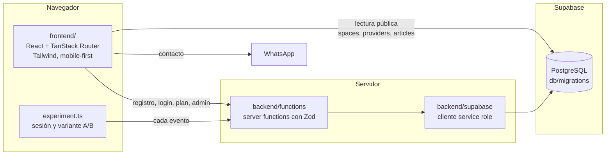

# Hauz, todo para tu perro en Montevideo

Marketplace de dos lados para dueños de perros. Junta en un solo lugar:
- proveedores verificados: paseadores, adiestradores, peluquerías y cuidadores
- un directorio de espacios pet-friendly
- una guía sobre cuidado y comportamiento

> Proyecto individual de Nuevos Emprendimientos Digitales, Licenciatura en Negocios Digitales, Universidad ORT Uruguay, 2026.

**[Ver el MVP](https://hauz-montevideo-perros.lovable.app)**

## Arquitectura



- **Frontend:** TanStack Start con rutas por archivo. Renderiza en el servidor y se hidrata en el navegador.
- **Backend:** server functions de TanStack Start. Corren solo en el servidor, validan cada entrada con Zod y son el único camino a los datos sensibles.
- **Base de datos:** PostgreSQL en Supabase con Row Level Security. El navegador solo lee el contenido público; perfiles, eventos y números de WhatsApp pasan por el backend.

## Estructura del repo

```
hauz-marketplace-mascotas/
├── frontend/                       app TanStack Start (Vite)
│   ├── src/routes/                 una ruta por archivo
│   │   ├── index.tsx               landing
│   │   ├── registro.tsx, login.tsx
│   │   ├── plan.tsx                elección de plan
│   │   ├── home.tsx                accesos según el plan
│   │   ├── espacios.*.tsx          directorio con filtros por barrio y categoría
│   │   ├── servicios.tsx           proveedores y contacto por WhatsApp
│   │   ├── orientacion.*.tsx       artículos
│   │   ├── perfil.tsx              datos y actividad del usuario
│   │   └── admin.tsx               panel con métricas del experimento
│   ├── src/lib/experiment.ts       sesión, variante A/B y registro de eventos
│   ├── src/lib/analytics.ts        visitas por sección
│   └── src/integrations/supabase/  cliente público
├── backend/
│   ├── functions/                  server functions
│   │   ├── profiles.functions.ts   registro, login, perfil, plan, tracking y admin
│   │   ├── eventos.functions.ts    eventos del A/B
│   │   └── providers.functions.ts  WhatsApp del proveedor bajo pedido
│   └── supabase/client.server.ts   cliente con service role, solo servidor
├── db/
│   ├── migrations/                 esquema real, en orden
│   ├── queries/metricas_ab.sql     hipótesis central y embudo por variante
│   └── types.ts                    tipos generados del esquema
└── specs/
    ├── hipotesis_y_resultados.md   sistema de hipótesis y resultados
    ├── investigacion.md            instrumentos de campo
    └── modelo_de_negocio.md        TAM/SAM/SOM, unit economics, pivots
```

## Cómo correrlo

Necesitás Node 20 o más y un proyecto de Supabase.

```bash
npm install
cp frontend/.env.example frontend/.env    # completá las claves de Supabase
npm run dev                               # http://localhost:8080
```

Para crear las tablas, aplicá `db/migrations` en orden (ver [db/README.md](db/README.md)).

Variables de entorno:

| Variable | Dónde se usa |
|---|---|
| `VITE_SUPABASE_URL`, `VITE_SUPABASE_PUBLISHABLE_KEY` | Cliente público en el navegador |
| `SUPABASE_URL`, `SUPABASE_SERVICE_ROLE_KEY` | Backend, nunca llega al navegador |
| `ADMIN_PASSWORD` | Clave del panel `/admin`; sin ella el panel queda cerrado |
| `VITE_WHATSAPP_CONCIERGE` | Número del concierge para el botón de contacto |

```bash
npm run build      # build de producción (Cloudflare Workers vía Nitro)
npm run lint
```

## El experimento

- **Hipótesis central:** si la integración tiene valor, al menos el 60 % de los usuarios va a usar más de una dimensión sin que se lo pidan.
- **Asignación:** cada sesión recibe la variante A o B al azar y la conserva; todos los eventos se guardan con su variante.
- **Eventos:** `sesion_inicio`, `registro_completo`, `ver_planes`, `elegir_plan`, `ver_dimension`, `click_whatsapp`.
- **Medición:** [`db/queries/metricas_ab.sql`](db/queries/metricas_ab.sql) y el panel `/admin`, que calcula el % de usuarios con más de una dimensión.

## Resultados

- **Hipótesis central validada:** el 63 % de los usuarios del MVP (19 de 30) usó más de una sección sin que se lo pidieran.
- **A/B:** mostrar los planes después de navegar llevó a elegir más el plan integrado. La integración se valora después de vivirla.
- **Mercado:** TAM de USD 75 M por año, SAM de USD 33,75 M y SOM de USD 1,13 M de GMV al año 3. Base: censo INE 2023, con 1.448.224 perros en Uruguay.
- **Precio:** con la técnica Van Westendorp, la banda óptima de suscripción quedó entre $400 y $600 por mes.
- **Unit economics proyectados:** suscripción de $500 por mes más 10 % de comisión, margen de contribución del 62,5 % y LTV/CAC de 5,0.
- **Pitch:** presentado ante un jurado con asesores de ANDE y ANII.

Detalle en [specs/](specs/).

## Decisiones de diseño

- **Server functions en lugar de una API aparte:** el backend vive en el mismo deploy, con tipos compartidos de punta a punta y sin CORS.
- **Defensa en capas para los datos personales:** RLS en la base, columnas revocadas (el WhatsApp del proveedor), cliente service role cargado solo dentro de los handlers y validación con Zod en cada entrada.
- **Eventos escritos solo por el servidor:** al principio el navegador insertaba directo; después se revocó ese permiso para que nadie pudiera inflar las métricas.
- **Login sin contraseña para el MVP:** registro con email y sesión local. Bajaba la fricción para los 30 usuarios del test; para producción va Supabase Auth.
- **Mobile-first:** contenedor de 448 px y navegación inferior, porque el segmento usa el celular.
- **Secretos fuera del código:** la clave del admin y el número de WhatsApp van por variables de entorno.

## Roadmap

- [x] Tres dimensiones operativas con filtros
- [x] Registro, elección de plan y perfil
- [x] Tracking propio de eventos y variante A/B
- [x] Panel admin con la métrica de la hipótesis central
- [ ] Supabase Auth con magic link en lugar de la sesión local
- [ ] Flujo de pago simulado para medir disposición de pago real
- [ ] Panel del proveedor: perfil, agenda y valoraciones
- [ ] Onboarding que muestre los planes después de navegar, según el resultado del A/B

## Aprendizaje

La disposición a pagar que la gente declaró en la encuesta no apareció cuando hubo que cobrar, ni en consumidores ni en proveedores. Con esa evidencia decidí no seguir con la idea. Validar el pago real antes de construir es la lección que me llevo.

## Stack

TanStack Start · React 19 · TypeScript · Tailwind CSS 4 · Supabase (PostgreSQL, RLS) · Zod · Vite · Lovable

---

**Romina Cor Castro** · [Portafolio](https://rominacor21.github.io) · [LinkedIn](https://www.linkedin.com/in/rominacor/)
