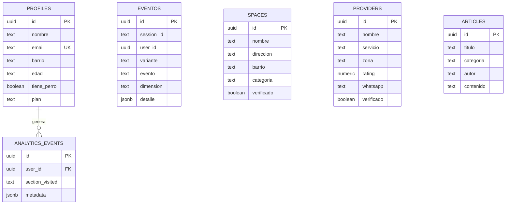

# Base de datos

PostgreSQL en Supabase (Lovable Cloud). Las migraciones son las mismas que corrieron en el proyecto, en orden cronológico.

## Modelo



- **spaces, providers y articles:** el contenido de las tres dimensiones. Lectura pública.
- **profiles:** usuarios del MVP y el plan que eligieron.
- **analytics_events:** visitas por sección de cada usuario registrado. Alimenta el panel `/admin`.
- **eventos:** tracking del test A/B por sesión, con la variante asignada.

## Migraciones

| Archivo | Qué hace |
|---|---|
| `20260610180944` | Crea las cinco tablas iniciales con RLS e índices |
| `20260610200359` | Cierra `profiles` y `analytics_events` al público: solo el servidor las lee y escribe |
| `20260617130856` | Crea `eventos` para el test A/B |
| `20260617131213` | Solo permite insertar eventos propios o anónimos |
| `20260617131413` | Oculta la columna `whatsapp` de `providers` al cliente |
| `20260701003955` y `20260701004234` | Pasa la escritura de `eventos` al servidor y revoca el insert directo desde el navegador |

La historia muestra cómo se fue endureciendo la seguridad a medida que el MVP tuvo usuarios reales.

## Consultas

[`queries/metricas_ab.sql`](queries/metricas_ab.sql): uso cruzado de dimensiones (la hipótesis central), dimensión de entrada, embudo por variante y clics en WhatsApp.

## Tipos

[`types.ts`](types.ts) son los tipos de TypeScript generados por Supabase a partir de este esquema. Los usan el frontend y el backend.

## Aplicar el esquema

```bash
supabase link --project-ref <tu-proyecto>
supabase db push        # aplica db/migrations en orden
```

O pegá los archivos en orden en el SQL Editor de Supabase.
